# i3wm-config — monochrome i3 edition

An **i3wm (X11)** port of [LinuxBeginnings/Hyprland-Dots](https://github.com/LinuxBeginnings/Hyprland-Dots).
Hyprland is a Wayland compositor, so every Wayland-only piece was swapped for an X11 equivalent while keeping
the keybinds, and restyled as a **simple, sleek black & white** desktop: flat white-on-black polybar with roman-numeral
workspaces, chunky borders and gaps, monochrome rofi / dunst / kitty / ghostty / cava, four photo wallpapers (or pick any accent colour in Settings > Colors), and a
**Pokémon fastfetch** greeting in every new **Ghostty** (or kitty) window. Ghostty is the default terminal; kitty is the automatic fallback.

**Design & tools** follow [addy-dclxvi/i3-starterpack](https://github.com/addy-dclxvi/i3-starterpack) (gaps, thick borders, roman workspaces),
[TheDistroHopper/i3wm-nord](https://github.com/TheDistroHopper/i3wm-nord) and [traumachan7219-collab/i3-dots](https://github.com/traumachan7219-collab/i3-dots)
(i3 + polybar + picom + rofi + dunst + kitty + feh + i3lock), recolored to pure monochrome. The keybinds follow the original (`SUPER+H` lists them) and can be changed in the Settings window (`SUPER+ALT+M`, Keybindings tab).

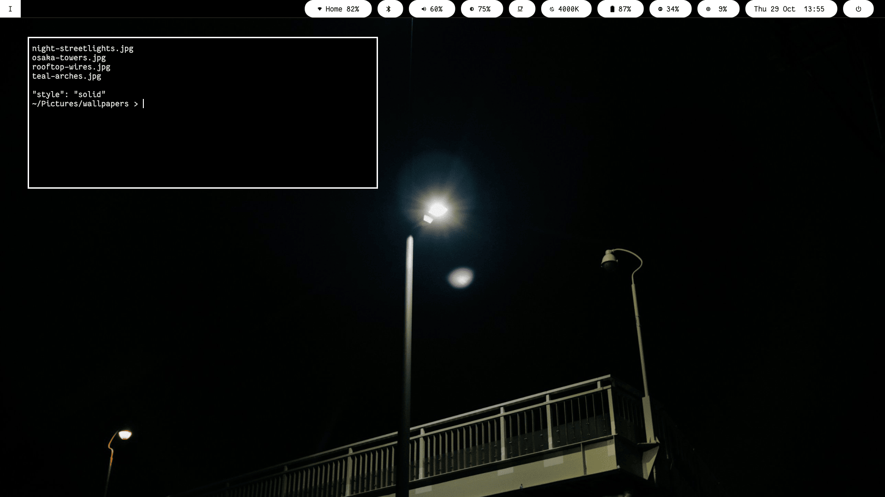

The bar in the default style - every item in its own block in your accent colour (Settings > Appearance > Bar):


All fourteen bar styles (each also comes in twelve block shapes, any colour, three sizes and adjustable spacing):

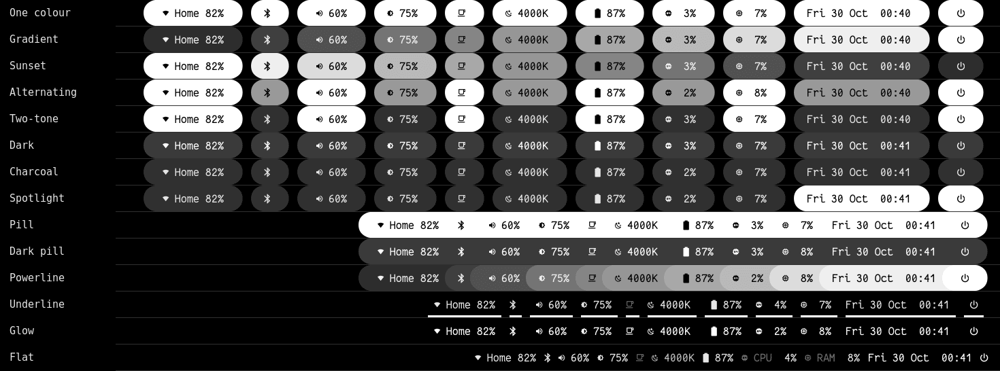

And the twelve block shapes (Settings > Appearance > Bar > Block shape):

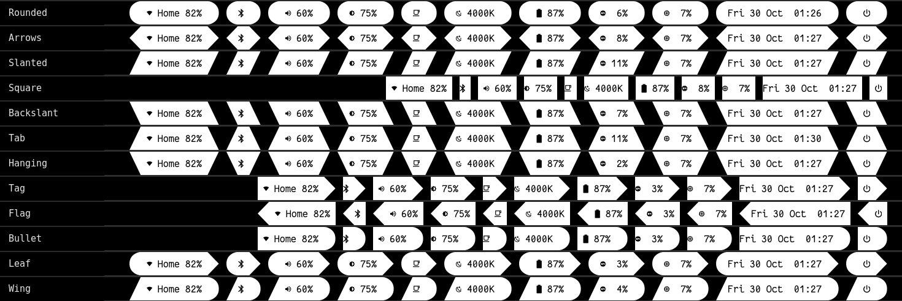

Notifications (volume, brightness, microphone, stay-awake, night light, game mode, touchpad, airplane mode...) use simple white icons, and their level bar follows your accent colour:

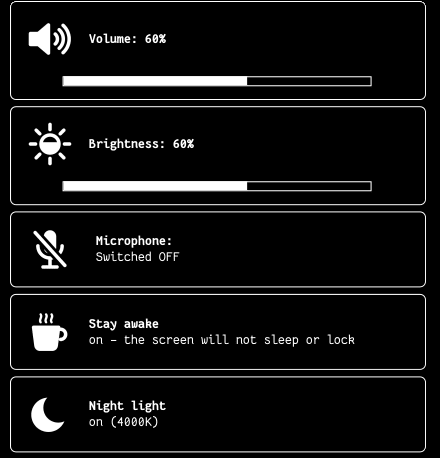

## Quick start

Works from a **KDE or GNOME** desktop (or anything else): the installer adds i3 and Xorg *next to* your current desktop,
so you keep both and pick one at the login screen. Primary target: **Fedora**; also Arch-based and Debian/Ubuntu-based systems.

```bash
git clone https://github.com/OmitGhostly/i3wm-config.git
cd i3wm-config
chmod +x install.sh
./install.sh
```

Or without cloning:

```bash
bash <(curl -fsSL https://raw.githubusercontent.com/OmitGhostly/i3wm-config/main/install.sh)
```

Then log out and choose the **i3** session (GNOME: gear icon on the login screen; KDE: session menu, bottom-left).
Press **`SUPER + H`** for the full keybind list. Do not run it with `sudo` - it asks for your password only when installing packages.

### Installer options

| Option | What it does |
|---|---|
| *(none)* | Install i3 + all dependencies, then the dotfiles |
| `--no-packages` | Only copy the dotfiles (you already have the programs) |
| `--no-ghostty` | Don't install Ghostty (kitty is used as the terminal) |
| `--no-pokemon` | Don't clone pokescript (a bundled shiny Mimikyu sprite is used) |
| `--wallpapers` | Also download the full KooL wallpaper bank into `~/Pictures/wallpapers` |
| `--no-backup` | Overwrite existing configs instead of moving them aside |
| `--restore` | Put back the newest `*.bak-*` backups and exit |
| `--dry-run` | Print what would happen without changing anything |

Existing folders in `~/.config` that the installer replaces are moved to `<name>.bak-<timestamp>` (only the first time; later re-installs overwrite the earlier install instead of making new backups).
Every run is logged to `~/.cache/i3wm-dots-install.log` - attach it when reporting a problem.
Each package is checked against your distro's repos before installing, so one missing name never aborts the rest;
anything that could not be installed is listed at the end.

### Fedora notes

- **Xorg is required.** The installer adds `xorg-x11-server-Xorg`. i3 is an X11 window manager; it runs as its own login session even if your GNOME/KDE session is Wayland.
- **Login screen:** if "i3" is missing from the session list, your display manager may not offer X11 sessions (recent Fedora releases moved GNOME to Wayland-only). SDDM and LightDM do:
  `sudo dnf install sddm && sudo systemctl disable gdm && sudo systemctl enable sddm`
- **Ghostty** has no official Fedora package, so the installer enables the community COPR `pgdev/ghostty` and installs it from there (use `--no-ghostty` to skip). If that fails, kitty is used automatically. On Debian/Ubuntu Ghostty has no repo package, so kitty is used.
- **clipmenu** is not in Fedora's repos, so the installer uses **CopyQ** instead (same keybind, `SUPER+ALT+V`).
- **Pokémon fastfetch:** the greeting always shows a **shiny Mimikyu** from [acxz/pokescript](https://github.com/acxz/pokescript) next to `fastfetch` system info. The installer clones pokescript to `~/.local/share/pokescript` (a copy of the sprite also ships in `~/.config/fastfetch/` as a fallback; MIT licence, see `POKESCRIPT-LICENSE.txt`). The greeting only runs inside Ghostty or kitty. Skip it with `--no-pokemon`.

- **FantasqueSansM Nerd Font** (bar/terminal icons) is downloaded to `~/.local/share/fonts` if missing.
- Requires **i3 >= 4.22** (`gaps` are built in); current Fedora releases ship newer.

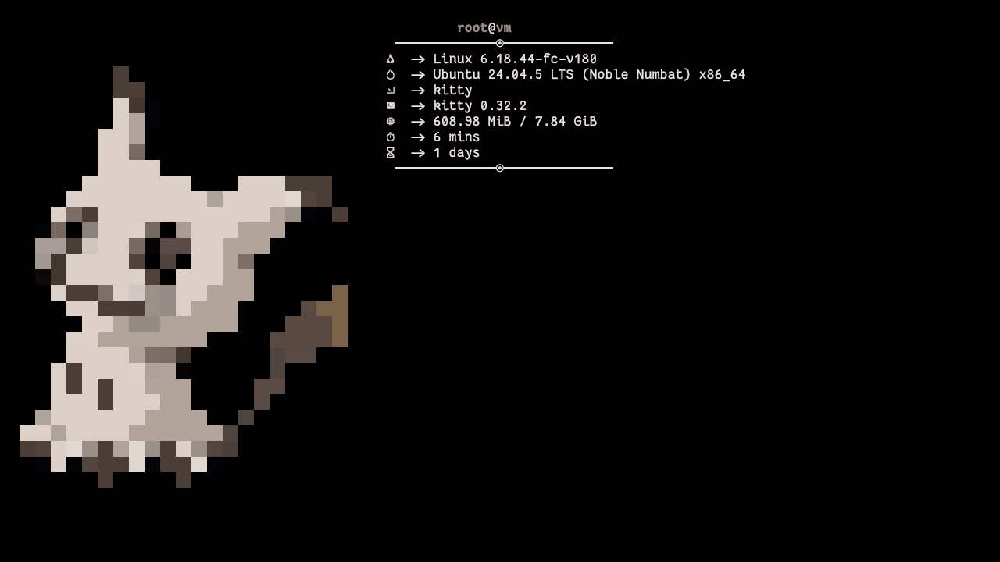

New windows tile in a spiral, the same way Hyprland does it (`SUPER+ALT+T` switches to classic side-by-side tiling):

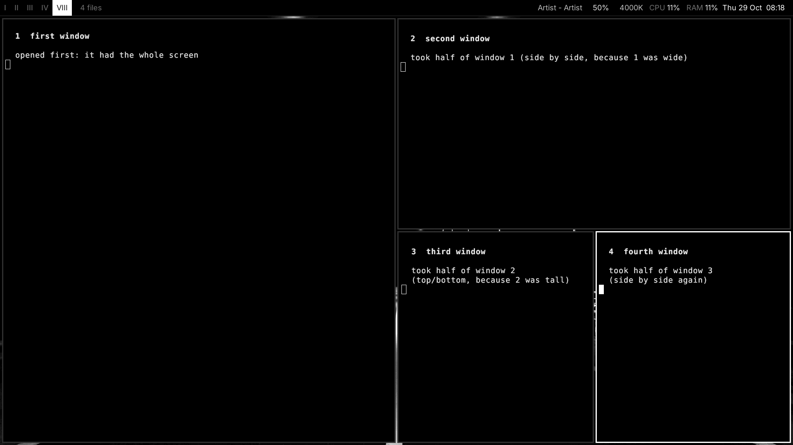

## Updating

**Automatically, with your system updates.** The installer sets up a small hook, so when you update your system - `sudo pacman -Syu` (Arch, CachyOS...), `sudo dnf upgrade` (Fedora) or `sudo apt upgrade` (Debian/Ubuntu) - the desktop config is updated from this GitHub repo too:

- The hook (a pacman hook in `/etc/pacman.d/hooks`, dnf's *actions* plugin in `/etc/dnf/libdnf5-plugins/actions.d`, or an apt `Post-Invoke` line) runs as root but changes nothing itself: it only asks *your* session to check GitHub (the `i3dots-update` user service). If you were not logged in at the time, it happens at your next login.
- Your session fetches the newest version into a private copy (`~/.local/share/i3wm-dots-updater/repo`). Only when something changed does it re-install the config files (`install.sh --update`: no packages, no password), reload i3 and show a notification.
- **Kept:** everything you set in the Settings window (accent colour, bar style and shape, keybindings, mouse, monitors, gaps, opacity, themes - `settings.json`) and your wallpaper. **Replaced:** hand edits to the files in `~/.config/i3`, `polybar`, `picom`, ... - use the Settings window for your changes, or turn automatic updates off.
- `i3dots-update --undo` puts back the config from before the last update. If an update fails, that happens by itself.

| Command | What it does |
|---|---|
| `i3dots-update` | update now (also when automatic updates are off) |
| `i3dots-update --check` | only say whether a newer version is on GitHub |
| `i3dots-update --undo` | go back to the config from before the last update |
| `i3dots-update --off` / `--on` | turn the automatic updates off / on |
| `i3dots-update --status` | the settings, the installed version and whether the hook is set up |
| `i3dots-update --install-hook` / `--remove-hook` | add / remove the system update hook (asks for your password) |

`i3dots-update` lives in `~/.local/bin` (if that is not in your PATH, run `~/.local/bin/i3dots-update`). The hook is set up when you run `./install.sh` (it uses `sudo` for the packages anyway); after `./install.sh --no-packages`, run `i3dots-update --install-hook` once. `./install.sh --no-auto-update` installs without automatic updates. On Fedora the hook needs dnf's actions plugin (`libdnf5-plugin-actions`), which the installer adds. Updates come from the repo you installed from (its GitHub address).

**By hand.** `git pull` and re-run `./install.sh` (it only adds programs that are missing, such as Touchégg for the swipe gestures; `--no-packages` skips that step): your original configs stay backed up as `*.bak-<timestamp>` (re-installs replace the previous install without piling up more backups, so `--restore` always returns your original setup), and your `~/.config/i3/settings.json` (Settings window choices) and wallpaper are kept.

## Security notes

- Everything runs as your user; only the package install step uses `sudo`, and only for your package manager.
- Automatic updates run code from this GitHub repo on your computer (as your user, not root): anyone who can push to the repo can change your desktop at your next system update. Turn them off with `i3dots-update --off` (or `i3dots-update --remove-hook`) if you install from a repo you do not control. The root-side hook only records the time and starts the user service; it never runs anything from the repo as root.
- Settings are validated before use: every value in `settings.json` is type- and range-checked when it is loaded (key combos, application commands, cursor and theme names, colours, monitor modes, positions, opacity and gaps), and the i3 config is tested with `i3 -C` before new keybindings are reloaded. Anything malformed is dropped and the default used, so a corrupt or hand-edited file can never crash the window or reach a config file. Config files are written atomically (a crash mid-write never leaves half a file).
- Menus that run things you pick (SSH hosts, music links, zsh themes) pass the choice as a plain argument, never through a shell, and refuse names that look like options.
- Third-party sources the installer can pull from: the `pgdev/ghostty` COPR (Fedora), the FantasqueSansM Nerd Font release download (not checksum-pinned), and acxz/pokescript (pinned to a fixed commit). Skip them with `--no-ghostty`, `--no-pokemon` or by installing the font yourself. Read `install.sh` before running it, as with any script you pipe from the internet.

## Troubleshooting

- No bar or wrong monitors: run `~/.config/polybar/launch.sh`; logs are in `$XDG_RUNTIME_DIR/polybar-<monitor>.log`.
- A keybind stopped working after editing: `i3 -C -c ~/.config/i3/config` shows the error; Keybindings > *Reset all to default* restores the shipped binds.
- Windows stacked as tabs instead of tiled: press `SUPER+ALT+1` (side by side); `SUPER+ALT+2/3` and `SUPER+G` switch to stacked/tabbed on purpose. New windows never open as tabs.
- A window without the focus ring (the border in your accent colour): every window gets it, including apps that draw their own title bar and ask i3 for no border (Chrome, VS Code, Discord, Spotify...), even when they ask after opening (`AutoTiling.py` puts it back). That includes a window that is alone on the screen. The exceptions are on purpose: fullscreen windows and mpv/vlc. Hide a border yourself with `border pixel 0` in the i3 config.
- Tiling: by default new windows tile in a **spiral like Hyprland** (each new window takes half of the focused one). `SUPER+ALT+T` switches to classic i3 (new windows side by side) and back; the choice is also in Settings > Appearance > Window tiling.
- Mimikyu greeting shows twice: another line in `~/.zshrc` or `~/.bashrc` also prints a greeting. Find it with `grep -n 'fastfetch\|PokeFetch\|pokemon' ~/.zshrc ~/.bashrc` and delete the line that isn't marked `# i3wm-dots`. Re-running the installer leaves exactly one of ours.
- No transparency, shadows or blur: the compositor could not use your GPU (common in virtual machines); `Picom.sh` then falls back to picom's software backend automatically. Toggle the compositor with `SUPER+ALT+O`.
- i3 itself froze or crashed: i3 shows a prompt to restart it in place (your windows stay open). Keep i3 up to date: 4.24 and 4.25 fixed several crashes (Debian/Ubuntu still ship 4.23).
- Three-finger swipes do nothing: Settings > Mouse & touchpad shows whether Touchégg is missing or its service is stopped (`sudo systemctl enable --now touchegg`); the gestures need a touchpad that reports three fingers (libinput) and an X11 session.
- App icons (Steam, Discord...) are not at the left end of the right-hand items, next to Wi-Fi: restart the bar (`~/.config/polybar/launch.sh`) or log out and in. The tray is a Polybar `internal/tray` module (Polybar 3.7 or newer); the bar on the primary monitor has it.
- The Wi-Fi tray icon is still there after updating: it goes at the next login, or right away with `~/.config/i3/scripts/NetApplet.sh restart`.
- The config did not update after a system update: `i3dots-update --status` shows whether the hook is set up and when it last checked; the log is `~/.cache/i3wm-dots-update.log`. `i3dots-update` updates by hand.
- Wallpaper: the one you pick (SUPER+W) is remembered in `~/.local/state/i3wm-dots/wallpaper` (not in `~/.cache`, which cleaners empty) and comes back at every login, on every monitor. It is drawn again after the screens are set up and whenever a screen is plugged in, unplugged or moved, so two monitors never get a misaligned picture.
- Install problems: attach `~/.cache/i3wm-dots-install.log`; `./install.sh --restore` brings back your old configs.

## Compatibility

Checked against the real tools, not only the docs:

| Tool | Check | Result |
|---|---|---|
| i3 4.23 | `i3 -C` config validation (all 153 binds, window rules, autostart) | passes |
| Polybar 3.7 | bar starts with all modules; i3 reserves the bar's space (workspace starts below the bar) | passes |
| picom 10 | starts with the shipped config; Fedora ships picom 13 (same options) | passes |
| dunst 1.9 | config parses without warnings (older-syntax values chosen for compatibility) | passes |
| rofi 1.7.5 | all 41 shipped `.rasi` themes/configs parse | passes |
| Scripts | `bash -n` + `shellcheck` clean; screenshot, wallpaper, reload, compositor toggle ran in a virtual X server | passes |

Fixed along the way: Polybar's `override-redirect` made i3 ignore the bar's reserved space (windows tiled underneath it) - removed.
Polybar, picom and pamixer are in Fedora 43/44 repos (confirmed on packages.fedoraproject.org).
**Not yet tested on real hardware:** Ghostty itself (it could not be installed in the test environment; the terminal key, drop-down terminal and fallback logic were tested with a stand-in), dunst running (needs a desktop D-Bus session), lock screen, touchpad / brightness / media keys, the three-finger swipe gestures (Touchégg needs a real touchpad; the workspace switching itself was tested against i3), hiding the Wi-Fi tray icon (tested with a stand-in for nm-applet), multi-monitor, and a real `dnf` run.

## Settings window

Press `SUPER+ALT+M` (or run `~/.config/i3/scripts/SettingsGUI.py`). Changes are applied immediately and saved to `~/.config/i3/settings.json`, which is re-applied at every login.

- **Mouse:** pick a device (or all mice and touchpads), set pointer speed, and turn acceleration on or off. The two work together, and each remembers its own speed: with acceleration **on** the slider sets how soon and how far the pointer speeds up when you move fast (that is all libinput's speed does there), with it **off** the slider is a plain multiplier for every movement, so flipping the switch brings back the speed you chose for that mode. A *Right now* line shows what the driver really reports for each device. Changes are felt right away (closing without Apply puts them back). *All mice and touchpads* sets every device; pick one to give it its own settings. A mouse plugged in later, or a Bluetooth mouse that reconnects after sleep, gets them too - and so does a keyboard (layout, key repeat) or touchpad (tap to click) that is plugged in later (`InputWatch.py`). **Touchpad gestures:** swipe with three fingers to change workspace - left goes to the next one (1 -> 2 -> 3, like a Mac; an empty workspace opens too), right goes back; the direction can be flipped or the gestures switched off. They use [Touchégg](https://github.com/JoseExposito/touchegg) (installed and its service enabled by the installer). A **Mouse cursor** section below picks the cursor theme and size (with a preview). The choice is used by every kind of program, so the pointer stays the same over every window: plain X programs, i3 and the bar (X resources and the `default` cursor theme), GTK 3 and GTK 4 apps (their `settings.ini`, and live through `xsettingsd`, so open GTK apps switch at once; Flatpak apps follow it too), and Qt / Electron / Java apps (`XCURSOR_THEME` / `XCURSOR_SIZE`, from the next login: `~/.xprofile` and `~/.config/environment.d`). i3 itself loads the cursor only when it starts, and every window that does not pick its own cursor (GTK windows like the Settings window, most pop-ups) shows i3's - so after a change i3 restarts in place once (windows stay as they are, like `SUPER+SHIFT+R`), and the cursor is also written to `~/.Xresources` / `~/.xprofile` so the next session starts with it. Other programs that are already open pick it up when you restart them.
- **Displays:** a Windows-style layout grid. Drag the numbered screens to match your desk; they snap to each other's edges. Click a screen to set its resolution, refresh rate, orientation (landscape, portrait, flipped), **scale** (100-300%; makes everything bigger on that screen, done with `xrandr --scale`, so values above 100% look slightly softer than native), enable/disable it (a screen you switch off stays in the window, greyed out along the bottom of the grid: click it and turn *Enabled* back on), or make it primary. **Identify** flashes each screen's number on that monitor.
- **Appearance:** sliders for the opacity of the focused window, of unfocused windows and of the **terminal background** (20-100%; the terminal slider writes `background-opacity` for Ghostty and `background_opacity` for kitty and reloads them live, so only the terminal's background turns see-through). Writes `active-opacity` / `inactive-opacity` in `~/.config/picom/picom.conf` and restarts picom. Needs the compositor running. The same tab sets the **gaps** between windows and around the screen edge (0-40 px) and whether a lone window gets no gaps; these are written to `gaps inner` / `gaps outer` / `smart_gaps` in `~/.config/i3/config`. **Window tiling** chooses how new windows are placed: *Spiral, like Hyprland* (the default: a new window takes half of the window you are using, side by side when it is wide and top/bottom when it is tall, the same as Hyprland's dwindle layout) or *Classic i3* (new windows open next to each other); `SUPER+ALT+T` switches between them too. A **Bar** section sets the bar's **style**, picked from a list that shows a small picture of each one in your colour, with a live **preview** of your exact choice underneath (it follows the Colors tab too): *One colour* (the default: every item on the right - Wi-Fi, Bluetooth, volume, brightness, stay-awake, night light, battery, CPU, RAM, GPU, the clock and the power button - sits in its own block in your accent colour, with black or white text picked for contrast), *Gradient* (blocks shading from dark to your colour), *Sunset* (the other way round: from your colour to dark), *Alternating* (two shades of your colour), *Two-tone* (your colour and charcoal, taking turns), *Dark* (dark blocks with text in your colour), *Charcoal* (grey blocks, white text), *Spotlight* (grey blocks, with the clock and the power button in your colour), *Pill* (every item in one long block), *Dark pill* (the same, dark with text in your colour), *Powerline* (blocks joined in a chain), *Underline* (plain text with a line in your colour under each item), *Glow* (plain text in your colour) or *Flat* (plain text, the original look). The **block shape** (also with pictures) sets how the ends of the blocks look: *Rounded*, *Arrows*, *Slanted*, *Square*, *Backslant* (slanted the other way), *Tab* (wider at the bottom), *Hanging* (wider at the top), *Tag* (flat start, pointed end), *Flag* (pointed start, flat end), *Bullet* (flat start, round end), *Leaf* (round start, pointed end) or *Wing* (slanted start, round end). In Powerline a shape with a flat start chains its blocks square, and **Space between blocks** (0-40 px, default 12) how far apart they are. Items your computer has no hardware for (battery on a desktop, Bluetooth, brightness, a GPU sensor) are left out instead of leaving a gap. The active window's title and the song/video that is playing are hidden unless you switch them on (*Show the window title*, *Show what is playing*). Also: the position (top or bottom; left/right is not possible with Polybar), the **size** (Normal: 30 px bar with 16 px text, Large: 38 px with 18 px - the default, Extra large: 44 px with 22 px) and which monitors show it (all, or only the ones you tick, numbered like the Displays tab). The text is drawn at exactly those pixel sizes and the rounded / arrow ends exactly as tall as the bar, which keeps everything sharp (Polybar's own `pixelsize` setting came out at 16.6 px, which is what made the old Normal bar look soft).
- **Colors:** choose the accent colour of the whole setup - *Mono* (the default white), Cyan, Blue, Green, Purple, Pink, Red, Orange, Yellow, or any custom `#rrggbb` (too-dark colours are refused because they would be unreadable on black). It recolours window borders, the bar, rofi menus, notifications, the lock screen, the stay-awake button, the audio visualizer, the terminal greeting and the Settings window itself. Black and the greys stay. The choice is saved and re-applied at every login (also after re-installing). Terminal *palettes* are separate: use the Themes tab.
- **Themes:** pick a colour theme for **Ghostty** and for **kitty** from searchable lists, with a live preview of the background, text and the 16 terminal colours. Ghostty lists its built-in themes plus the ones in `~/.config/ghostty/themes`; kitty lists the bundled `kitty-themes`. Apply writes `theme = ...` (Ghostty) or the `include .../kitty-themes/NAME.conf` line (kitty) and reloads open terminals. *Monochrome (default)* is the shipped black & white theme. Each terminal also has a **Text size** (6-36 pt in half steps, with a *Default* button: 12 for Ghostty, 14 for kitty); the preview draws the text at that size. It writes `font-size` / `font_size` and open terminals pick it up (a Ghostty window you zoomed by hand with Ctrl +/- keeps its own size).
- **Keybindings:** every keybind with its description and a search box. Pick one, press **Change key...** and press the new combination (it can record combos i3 normally swallows, like `SUPER+Return`). If the combo is already used you can swap the two. Applying checks the result with `i3 -C`, writes it into `~/.config/i3/config` and reloads i3; **Reset** puts keys back. Rows for the **file manager, terminal and browser** show the program in brackets, e.g. `file manager (Dolphin)`; **Change application...** lists the installed alternatives (or any command you type) and saves the choice to `~/.config/i3/defaults.conf`. Your changes are remembered in `settings.json` and re-applied after a reinstall or update of the config.
- **Sound:** pick the output (speakers, headphones, HDMI monitor, Bluetooth headset...) and the microphone, set their volume (0-150%, the same range as the volume keys) and mute them, play a test sound, and set the volume of each app that is playing sound right now (Firefox, Spotify...). Switching the output moves what is already playing over to it. It uses `pactl`, so it works with PipeWire and PulseAudio; changes happen right away and the tab follows changes made with the volume keys. Two switches turn the volume-change and screenshot sound effects on or off. *Open full mixer* starts pavucontrol.
- **Bluetooth:** a power switch, the list of your paired devices (Connect / Disconnect / Forget), and **Add a device**: put the device in pairing mode, press *Search for devices*, pick it and press *Pair and connect*. It uses `bluetoothctl` (BlueZ; the installer sets up the service). Devices that need a PIN (some keyboards) can be paired with the *Open full Bluetooth manager* button (Blueman).
- **Wi-Fi:** a power switch, the networks in range (signal, security, saved/connected), Connect (asks for the password the first time; open and remembered networks just connect), Disconnect, Forget network, Scan again, and *Join a hidden network...*. It uses NetworkManager (`nmcli`). The password is passed to `nmcli` on its command line for a moment while joining, so other users on a shared computer could see it in the process list; use the full network editor (`nm-connection-editor`) there. Work/school logins (802.1X) also need the full editor. The Wi-Fi icon that NetworkManager's applet puts in the tray is **hidden** (the Wi-Fi item in the bar does the same job); the applet itself keeps running in the background so a saved network can still ask for its password. *Wi-Fi icon in the tray* brings the icon back.
- The window sizes itself to your screen and every tab scrolls, so the Apply button stays visible on small or scaled screens.
- Only one Settings window opens: pressing `SUPER+ALT+M` again brings it to the front. The bar opens tabs directly: click the Wi-Fi item for the **Wi-Fi** tab, right-click Bluetooth for the **Bluetooth** tab, right-click the volume for the **Sound** tab (or run `SettingsGUI.py --tab NAME`).
- After applying display changes you get 10 seconds to press **Keep**; if the screen goes dark, wait and the old layout is restored.

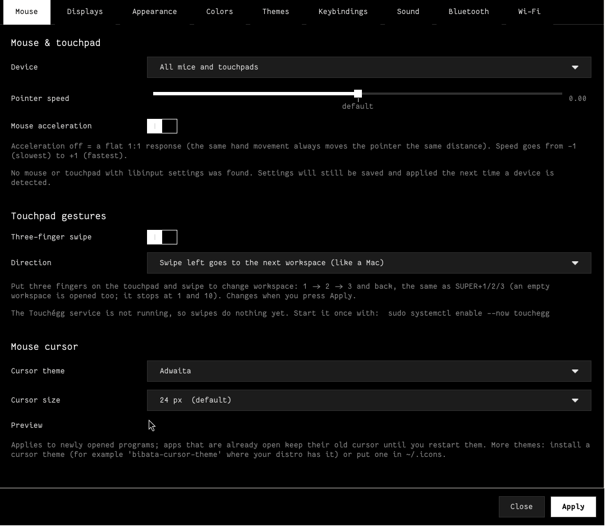
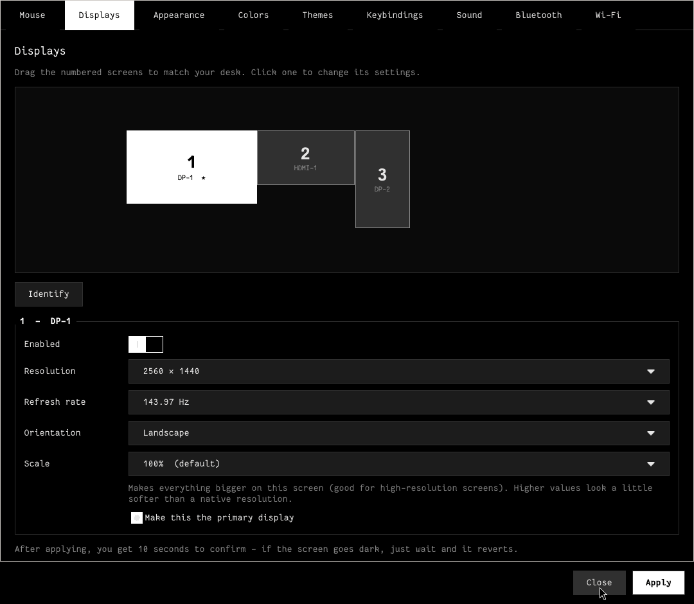
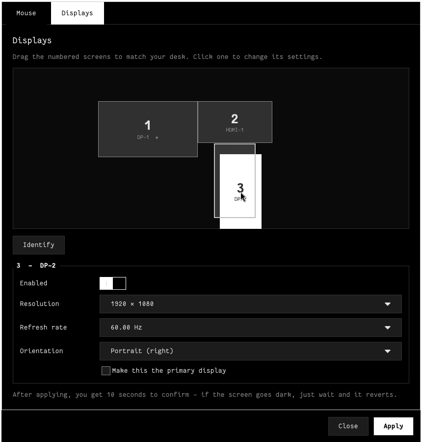
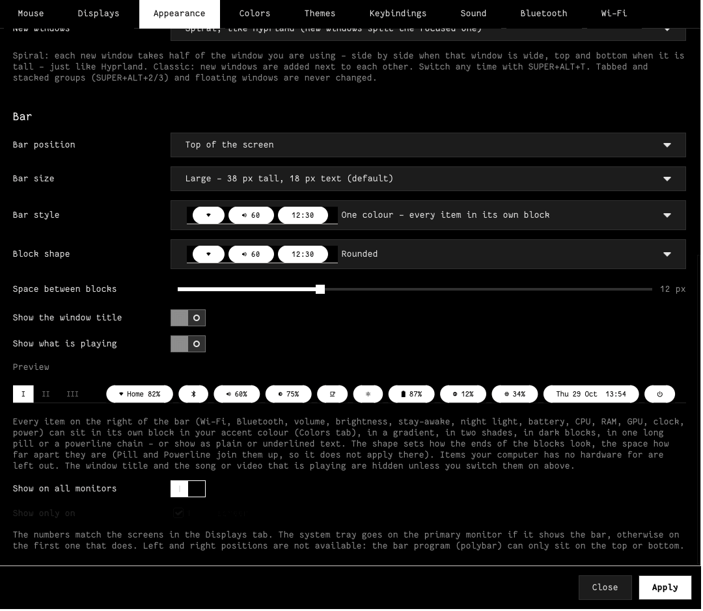
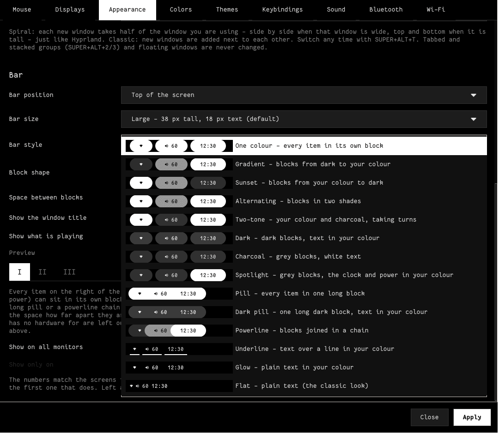
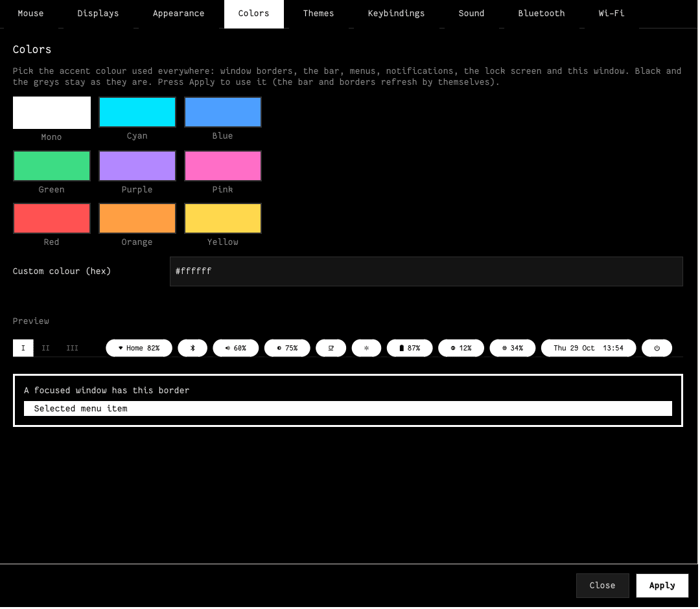

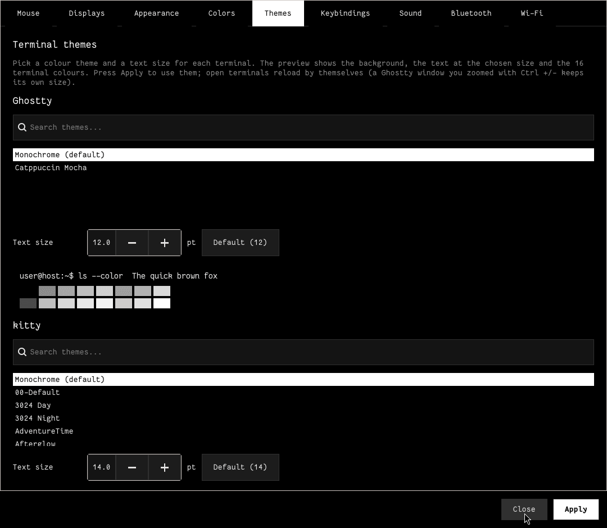
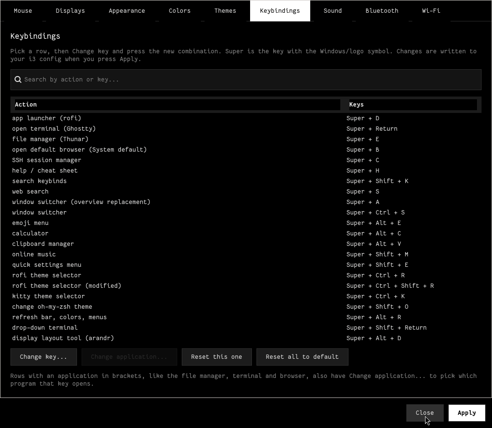
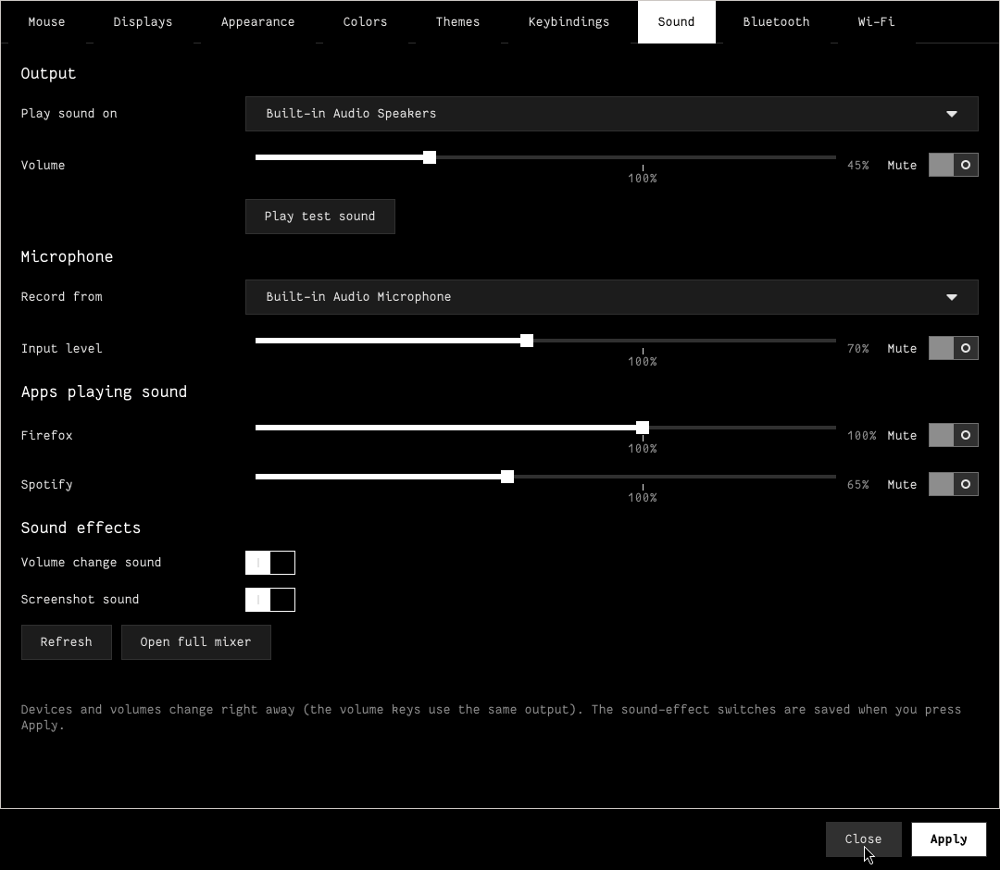
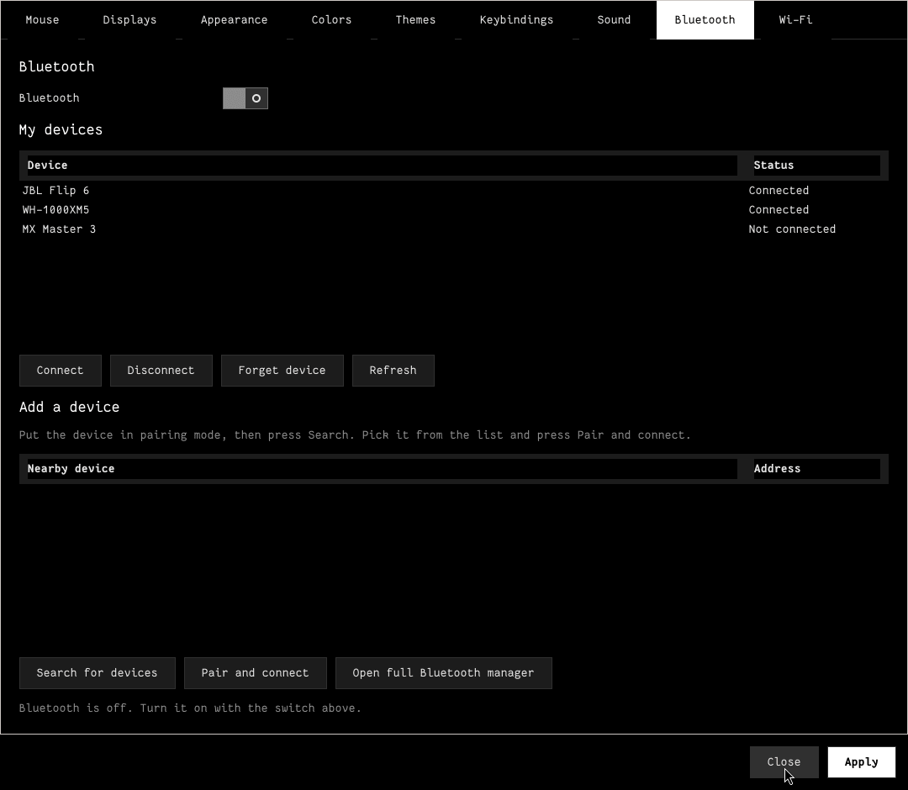
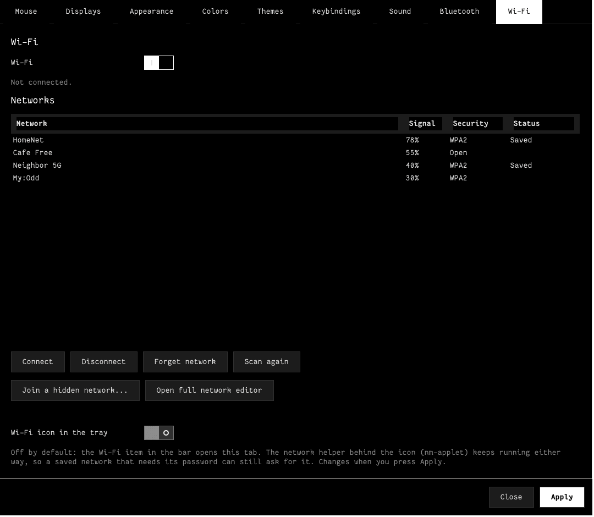

## Repository layout

```
├── install.sh          installer (see options above)
├── config/             mirrors ~/.config
│   ├── i3/             i3 config, scripts/, rofi/, icons/, defaults.conf
│   ├── polybar/        bar (replaces Waybar)
│   ├── picom/          compositor: blur, rounded corners, shadows
│   ├── dunst/          notifications (replaces swaync)
│   ├── touchegg/       touchpad gestures (three-finger swipe = next / previous workspace)
│   ├── gtk-3.0/        dark GTK theme setting
│   └── ghostty/ kitty/ (28 colour themes) fastfetch/ (Pokémon greeting) cava/ swappy/
├── wallpapers/         four photos (night street lights is the first one you see)
├── tools/              make_blocks.py (writes config/polybar/blocks.ini, the block bar styles) and
│                       make_icons.py (draws the white volume, microphone and brightness icons in config/i3/icons)
└── LICENSE.md          GPL-3.0 (inherited from the original project)
```

## What replaced what

| Hyprland dots | This port |
|---|---|
| Hyprland config (Lua) | `config/i3/config` — 153 keybinds, window rules, autostart |
| Waybar | Polybar (one bar per monitor; the system tray - Steam, Discord, any app icon - sits at the left end of the right-hand items, next to Wi-Fi, on the primary monitor) |
| swaync | dunst — `SUPER+SHIFT+N` shows history |
| Hyprland blur / rounding / shadow / dim | picom |
| swww / awww | feh (`Wallpaper.sh`) |
| hyprlock / hypridle | i3lock(-color) + xss-lock + `xset dpms` |
| wlogout | rofi power menu (`Powermenu.sh`) |
| nwg-displays / mouse settings | `SUPER+ALT+M` settings window (`SettingsGUI.py`) |
| grim / slurp | maim + xdotool + xclip |
| wl-copy / cliphist | xclip / clipmenu (CopyQ on Fedora) |
| hyprsunset | redshift (`Nightlight.sh`) |
| `[input]` block | `Input.sh` (setxkbmap / xset / xinput) |
| Special workspace | i3 scratchpad |
| Window groups | i3 tabbed / stacked containers |
| dwindle layout (spiral tiling) | `AutoTiling.py` - same spiral; `SUPER+ALT+T` turns it off/on |
| Quickshell / AGS overview | rofi window switcher (`SUPER+A`) |
| Hyprland touchpad gestures | Touchégg: three-finger swipe changes workspace (`Gestures.sh`, `Workspace.py`) |

## Keybinds (highlights)

| Keys | Action |
|---|---|
| `SUPER+Return` / `SUPER+D` / `SUPER+E` | terminal / launcher / file manager |
| `SUPER+Q` | close window |
| `SUPER+Arrows` · `SUPER+CTRL+Arrows` · `SUPER+SHIFT+Arrows` | focus · move · resize |
| `SUPER+1…0` · `SUPER+SHIFT+1…0` | workspace · move window to workspace |
| `SUPER+F` · `SUPER+SPACE` | fullscreen · floating |
| `SUPER+ALT+1/2/3` | split / stacking / tabbed layout |
| `SUPER+ALT+T` | spiral tiling like Hyprland (default) ⇄ classic side by side |
| three fingers ← / → on the touchpad | next / previous workspace |
| `SUPER+SHIFT+Return` · `SUPER+U` | drop-down terminal · scratchpad |
| `SUPER+W` · `CTRL+ALT+W` | pick wallpaper · random wallpaper |
| `SUPER+SHIFT+S` · `SUPER+Print` | screenshot (annotate) · screenshot |
| `SUPER+ALT+V` · `SUPER+ALT+E` · `SUPER+ALT+C` | clipboard · emoji · calculator |
| `CTRL+ALT+L` · `CTRL+ALT+P` | lock · power menu |
| `SUPER+SHIFT+E` | quick settings (edit configs, reload, restart) |
| bar coffee button (click) | stay awake: no screen blanking, auto-lock or idle suspend until you click again or log out (`Caffeine.sh`) |

Everything else: `SUPER + H`. To add your own bind, edit `~/.config/i3/config` and put a `## description` line above it so it shows up in the cheat sheet.
Change your default terminal / file manager in `~/.config/i3/defaults.conf`.

## Not ported (Hyprland/Wayland-specific)

Animation menus and presets, the dwindle/master/scrolling layout switcher, rainbow borders, the Hyprview/Quickshell/AGS overviews,
the monitor-profile manager (use `arandr`, `SUPER+ALT+D`), Waybar style/layout menus, hyprlock themes, Hyprland portal scripts,
and the original distro installers (`copy.sh`, `Distro-Hyprland.sh`, dots-tui).

## Dependencies

`i3 (≥4.22) xorg polybar picom dunst rofi ghostty|kitty feh maim xdotool xclip xss-lock i3lock imagemagick brightnessctl pamixer playerctl pavucontrol nm-applet redshift clipmenu|copyq numlockx xinput xrandr xprop xdpyinfo setxkbmap libnotify mpv qalc jq curl arandr thunar lxappearance fastfetch bluez blueman touchegg pactl (pulseaudio-utils / libpulse)`
· optional: `pokescript` (cloned by the installer), `swappy`/`flameshot`, `i3lock-color`, `polkit-gnome`, *FantasqueSansM Nerd Font*.

## Credits & license

All configs, themes and most scripts originate from **[LinuxBeginnings/Hyprland-Dots](https://github.com/LinuxBeginnings/Hyprland-Dots)** (KooL Dots) — thank you to the original author and contributors.
This port is distributed under the same **GPL-3.0-or-later** license.
